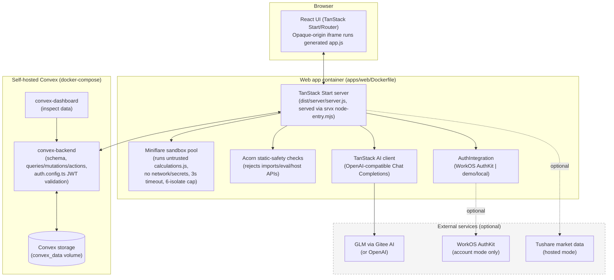

# Tech stack, packages, and architecture

This document covers everything needed to run Chengdu80 self-hosted: required
system packages, the full application dependency tree, and a high-level
architecture diagram. See also [README.md](../README.md) (quick start) and
[AGENTS.md](../AGENTS.md) (contributor rules).

## 1. System packages required to run this

Install these on the machine (or CI runner / Coolify host / k3s node) before
anything else:

| Tool                                             | Purpose                                                                                                | Notes                                                                                                                                           |
| ------------------------------------------------ | ------------------------------------------------------------------------------------------------------ | ----------------------------------------------------------------------------------------------------------------------------------------------- |
| [Bun](https://bun.sh) `1.3.x`+                   | Package manager, workspace task runner, script runtime                                                 | `curl -fsSL https://bun.sh/install \| bash`. Repo pins `packageManager: bun@1.3.13`.                                                            |
| [Node.js](https://nodejs.org) `22.12+`           | Runtime for the built server (`apps/web/server/node-entry.mjs`) and for tools that shell out to `node` | `@tanstack/react-start` requires Node ≥22.12. The self-hosted Docker image uses `oven/bun:1`, which bundles a compatible Node.                  |
| [Docker](https://docker.com) + Docker Compose v2 | Building/running the self-hosted stack (`apps/web/Dockerfile`, `docker-compose.yml`)                   | Required for `bun run docker:build`, `bun run deploy:hosted`, and running the self-hosted Convex backend. Not required for `bun run dev:local`. |
| `openssl` (or any random-hex generator)          | Generating `CONVEX_INSTANCE_SECRET` / `PLATFORM_INTERNAL_KEY`                                          | Any 32+ byte random string works; `openssl rand -hex 32` is the simplest source.                                                                |
| `git`                                            | Source control                                                                                         | —                                                                                                                                               |

Nothing else needs to be installed globally — `bun install` pulls every
JavaScript/TypeScript dependency into the workspace `node_modules`
automatically (incl. per-workspace hoisted copies under `apps/web/node_modules`,
`packages/*/node_modules`).

### Optional, only if you want self-hosted auth beyond demo mode

| Tool           | Purpose                                                                                                                         |
| -------------- | ------------------------------------------------------------------------------------------------------------------------------- |
| WorkOS account | Only needed if you disable `CD80_DEMO_MODE` and want real account login (`WORKOS_*` env vars). Not self-hostable — it's a SaaS. |

### Minimum container images pulled by `docker-compose.yml`

| Image                                                                        | Role                                                        |
| ---------------------------------------------------------------------------- | ----------------------------------------------------------- |
| Built from `apps/web/Dockerfile` (base: `oven/bun:1` → runtime `oven/bun:1`) | The TanStack Start app server                               |
| `ghcr.io/get-convex/convex-backend:latest`                                   | Self-hosted, open-source Convex database + function runtime |
| `ghcr.io/get-convex/convex-dashboard:latest`                                 | Web UI to inspect/query the self-hosted Convex data         |

## 2. Full dependency tree (by workspace)

The repo is a Bun workspace monorepo (`apps/*`, `packages/*`) with a shared
version `catalog` in the root `package.json`. ~625 resolved packages total
(including transitive deps); below are the direct dependencies that define
the stack.

### Root (`package.json`)

- **Task running**: `vite-plus` (`vp`) — dev/build/lint/format/typecheck runner for the whole workspace.
- **Shared catalog versions**: `zod`, `typescript`, `react`/`react-dom`, `convex`, `tailwindcss`, `@workos/authkit-tanstack-react-start`, `lucide-react`, `next-themes`, `sonner`, `@types/react*`.
- **Dev**: `@types/node`.

### `apps/web` — the TanStack Start application

| Package                                                       | Role                                                                                                                     |
| ------------------------------------------------------------- | ------------------------------------------------------------------------------------------------------------------------ |
| `@tanstack/react-start`                                       | Full-stack React framework: file-based routing, SSR, server functions                                                    |
| `@tanstack/react-router` (+ `-ssr-query`, `-devtools`)        | Client/server routing                                                                                                    |
| `@tanstack/react-query`                                       | Data fetching/caching                                                                                                    |
| `@tanstack/ai`, `@tanstack/ai-openai`, `@tanstack/ai-react`   | AI chat/generation primitives (OpenAI-compatible Chat Completions transport)                                             |
| `react`, `react-dom`                                          | UI runtime                                                                                                               |
| `@tailwindcss/vite`, `tailwindcss`                            | Styling                                                                                                                  |
| `@vitejs/plugin-react`                                        | Vite React Fast Refresh                                                                                                  |
| `@workos/authkit-tanstack-react-start`                        | WorkOS AuthKit integration (optional account-mode auth)                                                                  |
| `convex`                                                      | Convex client SDK (`ConvexReactClient`, `ConvexHttpClient`)                                                              |
| `@web-starter/backend`, `@web-starter/env`, `@web-starter/ui` | Internal workspace packages (see below)                                                                                  |
| `acorn`                                                       | Parses untrusted `calculations.js`/`app.js` source for the static-safety checks in `runtime.ts`                          |
| `miniflare`                                                   | Runs untrusted `calculations.js` in an isolated workerd sandbox (no Cloudflare account needed)                           |
| `srvx`                                                        | Universal server — serves static assets + dispatches SSR requests in the standalone Node build (`server/node-entry.mjs`) |
| `lucide-react`, `next-themes`, `sonner`                       | Icons, theming, toasts                                                                                                   |
| `zod`                                                         | Schema validation (specs, bundles, model outputs)                                                                        |
| `vite`, `vite-plus`, `typescript` (dev)                       | Build tooling                                                                                                            |

### `packages/backend` — Convex functions

| Package  | Role                                                                                                                                               |
| -------- | -------------------------------------------------------------------------------------------------------------------------------------------------- |
| `convex` | Convex server SDK — schema (`schema.ts`), queries/mutations/actions (`platform.ts`, `viewer.ts`, `healthCheck.ts`), auth config (`auth.config.ts`) |
| `zod`    | Input validation shared with the frontend                                                                                                          |

### `packages/ui` — shared design system

| Package                                                | Role                                                               |
| ------------------------------------------------------ | ------------------------------------------------------------------ |
| `@base-ui/react`                                       | Headless UI primitives (this shadcn setup uses Base UI, not Radix) |
| `shadcn`, `@shadcn/react`                              | shadcn/ui CLI + component conventions                              |
| `class-variance-authority`, `clsx`, `tailwind-merge`   | Class-name composition utilities for variant-based components      |
| `tw-animate-css`                                       | Tailwind animation utilities                                       |
| `lucide-react`, `next-themes`, `sonner`, `tailwindcss` | Shared with the app                                                |

### `packages/env` — typed environment access

| Package            | Role                                                                       |
| ------------------ | -------------------------------------------------------------------------- |
| `@t3-oss/env-core` | Schema-validated `import.meta.env` access for client-exposed `VITE_*` vars |
| `zod`              | Schema definitions                                                         |

### `packages/config`

Holds the shared `tsconfig.base.json` only — no runtime dependencies.

## 3. Full tech stack summary

| Layer                               | Technology                                                                                                                     |
| ----------------------------------- | ------------------------------------------------------------------------------------------------------------------------------ |
| Language                            | TypeScript (strict), React 19                                                                                                  |
| Package manager / monorepo          | Bun workspaces, `vite-plus` task runner                                                                                        |
| Frontend framework                  | TanStack Start (React) — SSR + client hydration                                                                                |
| Routing                             | TanStack Router (file-based)                                                                                                   |
| Data fetching                       | TanStack Query + `@convex-dev/react-query`                                                                                     |
| Styling                             | Tailwind CSS v4                                                                                                                |
| UI components                       | shadcn/ui on Base UI primitives (`packages/ui`)                                                                                |
| Backend / database                  | Convex (reactive database + serverless functions), self-hostable                                                               |
| Auth                                | WorkOS AuthKit (optional account mode) or a built-in demo/local `AuthIntegration` (`apps/web/src/integrations/auth`)           |
| AI / LLM integration                | TanStack AI, OpenAI-compatible Chat Completions — configurable provider: GLM via Gitee AI (default) or OpenAI                  |
| Untrusted code sandbox              | Miniflare (workerd-in-Node) — runs user-submitted `calculations.js` with no network/secret access, pooled isolates, 3s timeout |
| Source safety checks                | Acorn (AST parsing) — rejects imports, `eval`, host API access in imported bundles                                             |
| Build/runtime deploy target         | Standalone Node server (`dist/server/server.js` fetch handler + `srvx` adapter), containerized via Docker                      |
| Container orchestration (choice of) | Docker Compose (local/simple), Coolify (recommended self-hosted PaaS), or k3s + Argo CD (GitOps/cluster)                       |
| Market data (optional)              | Tushare (hosted) / Alpha Vantage demo endpoint (local mode)                                                                    |

**Explicitly not used**: Cloudflare Workers, Cloudflare KV/R2/D1/Durable Objects, Alchemy, Wrangler. (Removed in the self-hosted migration — see git history around `apps/web/Dockerfile` and `docker-compose.yml`.)

## 4. High-level architecture diagram



### Request lifecycle (creating/verifying an app)

1. Browser sends an English request → TanStack Start server function.
2. Server calls the configured AI provider (GLM/OpenAI) to draft a spec, then a source bundle (`manifest` + `index.html`/`app.js`/`calculations.js`/`style.css`).
3. `inspectSource()` (Acorn-based) statically rejects unsafe code (imports, `eval`, embedded secrets, unsafe HTML).
4. `execute()` runs `calculations.js` inside a pooled Miniflare isolate against fixture inputs to verify the numerical protocol contract (portfolio/screening/strategy).
5. On a passing `Verification`, the release is persisted to Convex (`packages/backend/convex/platform.ts`), scoped by `ownerId` (real account id, or the shared `demoOwnerId` in demo mode).
6. The browser renders the accepted app in an opaque-origin, CSP-restricted iframe, calling back into the server via `cd80.call(capability, input)` for market data, financial calculations, and storage.

## 5. Running it

See [README.md](../README.md) for exact commands. Summary:

```bash
# Prerequisites: bun, (optionally) docker + docker compose
bun install

# Fastest local check, no Docker/Convex required:
bun run dev:local

# Full self-hosted stack via Docker Compose (app + self-hosted Convex + dashboard):
bun run setup:selfhosted   # scripts/setup-selfhosted.sh, idempotent

# Full self-hosted stack on a local k3s cluster (via k3d), Ingress-routed,
# Convex deployed from the Kubernetes manifests in k8s/:
bun run setup:k3s          # scripts/setup-k3s.sh, requires: brew install k3d kubectl
```

### k3s / Kubernetes manifests

[`k8s/`](../k8s/) contains tested manifests:

- `convex.yaml` — self-hosted Convex backend (PVC-backed) + dashboard Deployments/Services.
- `web.yaml` — the app Deployment/Service. Note the `hostAliases` entry: `VITE_CONVEX_URL` is
  inlined into the browser bundle at build time, so the _same_ hostname must also resolve from
  inside this pod for server-side Convex calls. It's pointed at the Traefik Ingress ClusterIP so
  both the browser (via Ingress + a real/`/etc/hosts` DNS entry) and the pod itself reach Convex
  through the identical Ingress route — the same pattern a real public DNS hostname gives you for
  free in production.
- `ingress.yaml` — host-based routing for the app and Convex's two origins (cloud + site) plus the
  dashboard, all multiplexed through the cluster's Ingress controller (Traefik, bundled with k3s).

`scripts/setup-k3s.sh` automates: creating a k3d cluster with ports 80/443 mapped to the host,
building/importing the app image, deploying the manifests above, generating a Convex admin key, and
pushing Convex schema/functions — verified to work end-to-end from a fully torn-down state.

For a real (non-local) k3s/k8s cluster: replace `k3d image import` with pushing to a real registry
your cluster can pull from, and point real DNS records at your Ingress controller's external IP
instead of `/etc/hosts` — the manifests themselves don't change.
